# Metro Train Compressor Failure Analysis Using Exploratory Data Analysis, Visualization, and Deep Learning

## 1. Project Title and Concise Introduction

An end-to-end predictive maintenance and temporal anomaly detection system developed for the Air Production Unit (APU) compressor of an active passenger metro train (*Metro do Porto*, Portugal), using the official **UCI MetroPT-3 benchmark dataset**. This project executes a rigorous seven-stage data visualization workflow, leak-free chronological preprocessing, statistical state-shift modeling, a semi-supervised PyTorch Deep LSTM Autoencoder, and an interactive Streamlit diagnostics dashboard.

---

## 2. Verified Project Badges

[](https://www.python.org/downloads/release/python-3119/)
[](https://pytorch.org/)
[](https://streamlit.io/)
[](tests/test_pipeline.py)
[](https://archive.ics.uci.edu/dataset/791/metropt+3+dataset)
[](LICENSE)

---
---

<details open>
<summary><b>Table of Contents (24 Structured Sections)</b></summary>

| # | Section | Key Focus / Project Deliverables |
| :-: | :--- | :--- |
| **1** | [1. Project Title and Concise Introduction](#1-project-title-and-concise-introduction) | System identity, core scope, and summary of capabilities |
| **2** | [2. Verified Project Badges](#2-verified-project-badges) | Python 3.11, PyTorch 2.2+, Streamlit, 16 unit tests, MIT license |
| **3** | [3. Project Overview and Real-World Problem Statement](#3-project-overview-and-real-world-problem-statement) | Metro do Porto APU compressor physics and air leak failure mechanics |
| **4** | [4. Objectives and Project Scope](#4-objectives-and-project-scope) | 7-stage visualization, zero-leakage splits, PyTorch autoencoder |
| **5** | [5. Key Implemented Features](#5-key-implemented-features) | 10s binning, 17 300-DPI figures, Streamlit interactive app, 16 tests |
| **6** | [6. Screenshots and Visual System Telemetry Previews](#6-screenshots-and-visual-system-telemetry-previews) | Timeline error preview, micro-cycle dynamics, ROC/PR curves, attribution |
| **7** | [7. Dataset Description and Official Benchmark Source](#7-dataset-description-and-official-benchmark-source) | UCI MetroPT-3 (1.5M records, 15 features, 4 maintenance events) |
| **8** | [8. System Architecture and Pipeline Workflow](#8-system-architecture-and-pipeline-workflow) | End-to-end Mermaid flowchart from ingestion to live inference |
| **9** | [9. Technology Stack and Component Responsibilities](#9-technology-stack-and-component-responsibilities) | PyTorch, Pandas, Scikit-Learn, Streamlit, Matplotlib, Seaborn, Pytest |
| **10** | [10. Repository Directory Structure](#10-repository-directory-structure) | Full filesystem layout of data, figures, models, reports, and tests |
| **11** | [11. Environment Setup and Windows PowerShell Installation](#11-environment-setup-and-windows-powershell-installation) | Step-by-step Windows PowerShell commands and pinned dependencies |
| **12** | [12. Commands for Running Tests and Pipeline Reproduction](#12-commands-for-running-tests-and-pipeline-reproduction) | `pytest tests/ -v` (16 passed) & end-to-end retraining reproduction |
| **13** | [13. Instructions for Launching the Streamlit Dashboard](#13-instructions-for-launching-the-streamlit-dashboard) | Launching `dashboard.py` on `localhost:8501` |
| **14** | [14. Live Anomaly Inference Instructions](#14-live-anomaly-inference-instructions) | Method A (CSV batch upload) & Method B (60-step data editor) |
| **15** | [15. Data Preprocessing and Telemetry Feature Specifications](#15-data-preprocessing-and-telemetry-feature-specifications) | 15 telemetry channels, sampling rates, physical units, normalizer fit |
| **16** | [16. Deep Learning Model Architecture and Hyperparameter Configuration](#16-deep-learning-model-architecture-and-hyperparameter-configuration) | LSTM Autoencoder layers, latent bottleneck K=16, threshold tau=2.589630 |
| **17** | [17. Empirical Evaluation Results and Metric Definitions](#17-empirical-evaluation-results-and-metric-definitions) | ROC-AUC 0.8203, PR-AUC 0.0776, Recall 83.74%, 4/4 event captures |
| **18** | [18. Complete Visualizations Gallery and Analysis (All 17 Figures)](#18-complete-visualizations-gallery-and-analysis-all-17-figures) | Full gallery: 12 EDA figures + 5 model evaluation figures |
| **19** | [19. Statistical Findings and Sensor Attribution Analysis](#19-statistical-findings-and-sensor-attribution-analysis) | Continuous sensor stats, Cohen effect sizes, phase-space coupling |
| **20** | [20. Limitations, Challenges and Prediction vs. Anomaly Detection](#20-limitations-challenges-and-prediction-vs-anomaly-detection) | Detection vs. RUL forecasting, FP=33,258, operational sensor noise |
| **21** | [21. Troubleshooting Guide](#21-troubleshooting-guide) | Solutions for PowerShell execution policies, model loading, Streamlit ports |
| **22** | [22. References and Official Dataset Citation](#22-references-and-official-dataset-citation) | IEEE-formatted citations for UCI MetroPT-3 and baseline architectures |
| **23** | [23. Academic Project Details](#23-academic-project-details) | Course U21ADP05, KPR Institute of Engineering and Technology |
| **24** | [24. License and Contribution Guidelines](#24-license-and-contribution-guidelines) | Permissive MIT open-source license terms and PR guidelines |

</details>


## 3. Project Overview and Real-World Problem Statement

Modern Electrical Multiple Units (EMUs) in urban passenger transit rely fundamentally on an on-board pneumatic compressed air network. The core of this infrastructure is the **Air Production Unit (APU)**, which houses an electrically driven reciprocating air compressor, cooling coils, cyclonic oil mist separators, and dual-tower desiccant air dryers. Compressed air produced by the APU powers four mission-critical rail subsystems:

1. **Pneumatic Friction & Emergency Braking Circuits:** Regulated operating pressure ($8.5\text{ to }10.0\text{ bar}$) ensures passenger safety. If reservoir pressure drops below the critical $7.0\text{ bar}$ limit, emergency spring-applied brake actuators clamp automatically, halting the train.
2. **Secondary Pneumatic Air Suspension:** Modulates pressure in suspension bellows to keep passenger car floor height aligned with station platform levels as passenger crowding fluctuates.
3. **Automatic Passenger Sliding Doors:** Powers high-cycle pneumatic actuators opening and closing carriage doors at every station stop.
4. **Traction Pantograph Actuation:** Elevates and maintains constant mechanical contact pressure between the carbon collector strip and the 750V / 1500V DC overhead catenary power line.

### Failure Mechanics of Pneumatic Air Leaks
During nominal operations, the compressor cycles intermittently: it pumps until reservoir pressure reaches the upper governor cutoff limit ($\approx 10.0\text{ bar}$), transitions to an offloaded idling state, and discharges moisture through desiccant purge valves.

When an unaddressed pneumatic air leak develops (cracked pipe unions, deteriorating suspension valves, or failed seals), air escapes continuously. The motor pump governor forces the compressor to run under continuous duty cycle without adequate idle cooling periods. This produces severe Joule heating in the 3-phase motor windings, thermal degradation of lubricating oil, cyclonic filter clogging, and ultimate catastrophic seizure of the mechanical compressor block.

---

## 4. Objectives and Project Scope

* **Dataset Verification & Domain Auditing:** Verify the schema and integrity of the official UCI MetroPT-3 dataset against its primary literature (Veloso et al., *Scientific Data*, 2022) to confirm all 15 required domain features are present.
* **Leak-Free Preprocessing Pipeline:** Establish strict chronological boundaries (Train: Feb 28 – Mar 31; Val: Apr 1 – Apr 15; Test: Apr 16 – Aug 31) and fit normalizers strictly on the healthy training baseline, completely eliminating lookahead data leakage.
* **Comprehensive Exploratory Data Analysis & Statistical Modeling:** Produce 12 publication-grade, 300-DPI visualizations elucidating univariate operating distributions, digital duty cycles, macroscopic seasonal trends, microscopic thermodynamic cycles, bivariate phase-space couplings, and failure dynamics.
* **Structured Seven Visualization Stages:** Explicitly execute and document all seven stages of data visualization (Acquire, Parse, Filter, Mine, Represent, Refine, Interact) following the course curriculum framework.
* **Semi-Supervised Deep Learning Architecture:** Formulate, train, and evaluate a Deep LSTM Autoencoder that compresses multivariate temporal windows into a low-dimensional latent bottleneck ($K=16$) and reconstructs nominal operating dynamics.
* **Transparent Hyperparameter Documentation:** Record verified model parameters, computational constraints, and an honest account of architecture selection versus future systematic tuning.
* **Dynamic Anomaly Thresholding & Real Metric Evaluation:** Establish a statistical decision threshold $\tau = 2.589630$ strictly on uncontaminated validation data, score reconstruction errors across the 4.5-month test stream ($160,015$ sequence windows), and evaluate point-wise and event-level detection performance against confirmed operator maintenance logs.
* **Interactive Diagnostic Prediction Workflow:** Deliver an interactive Streamlit monitoring dashboard supporting live CSV file upload, in-browser tabular sequence editing, historical benchmark execution, and automated prediction export.
* **Automated Quality Assurance:** Validate the pipeline with 16 passing unit tests covering data hygiene, leakage prevention, figure generation, inference math, and statistical properties.

---

## 5. Key Implemented Features

* **10-Second Calendar Bin Regularization:** Standardizes non-uniform telemetry deltas into $1,504,107$ uniform 10-second calendar bins, eliminating hardware clock drift jitter.
* **Zero-Leakage Feature Scaling:** `StandardScaler` fitted strictly on healthy baseline training records, avoiding division by near-zero IQRs on resting sensors.
* **17 Publication-Grade Visualizations:** All rendered at 300 DPI with consistent typography and color palettes (12 EDA figures + 5 evaluation figures).
* **Deep LSTM Autoencoder:** PyTorch implementation ($15 \rightarrow 64 \rightarrow 32 \rightarrow 16 \rightarrow 32 \rightarrow 64 \rightarrow 15$) modeling multi-sensor temporal autocorrelations.
* **Root-Cause Sensor Attribution:** Per-channel reconstruction error decomposition isolating which physical sensor drives an anomaly alert.
* **Live Interactive Prediction Dashboard:** Streamlit application providing batch CSV upload (Method A), interactive in-browser 60-step data editor (Method B), one-click historical benchmarks, and prediction export.
* **Multi-Format Academic Deliverables:** Complete project report generated in Markdown, Word (`.docx` with all 17 embedded images), and PDF (`.pdf` with all 17 embedded images and running headers/footers).
* **Automated Unit Test Suite:** 16 automated tests covering pipeline integrity, inference math, effect sizes, and configuration consistency.

---

## 6. Screenshots and Visual System Telemetry Previews

### Model Evaluation & Diagnostic Visualizations (Sample Preview)

| 4.5-Month Anomaly Score Timeline vs. Dynamic Threshold | Microscopic Thermodynamic Compression Cycle (20 min) |
| :---: | :---: |
| 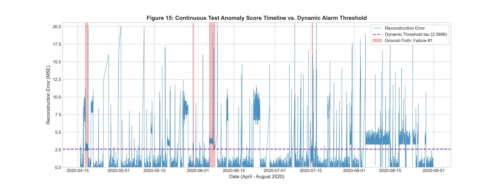 | 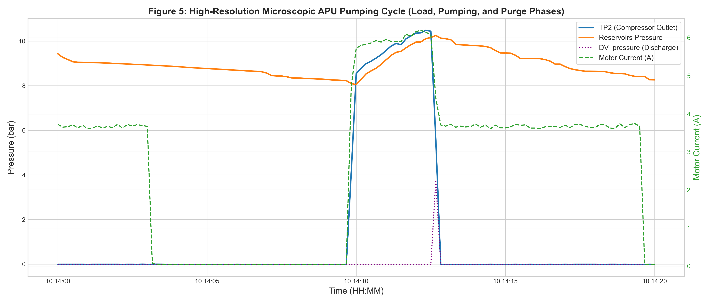 |
| *Figure 15: Continuous test stream reconstruction error spiking during failure events against threshold $\tau = 2.589630$.* | *Figure 5: High-resolution pumping dynamics (TP2, current, reservoir pressure) confirming $W=60$ captures full cycles.* |

| Receiver Operating Characteristic & Precision-Recall Curves | Per-Channel Sensor Reconstruction Error Attribution |
| :---: | :---: |
| 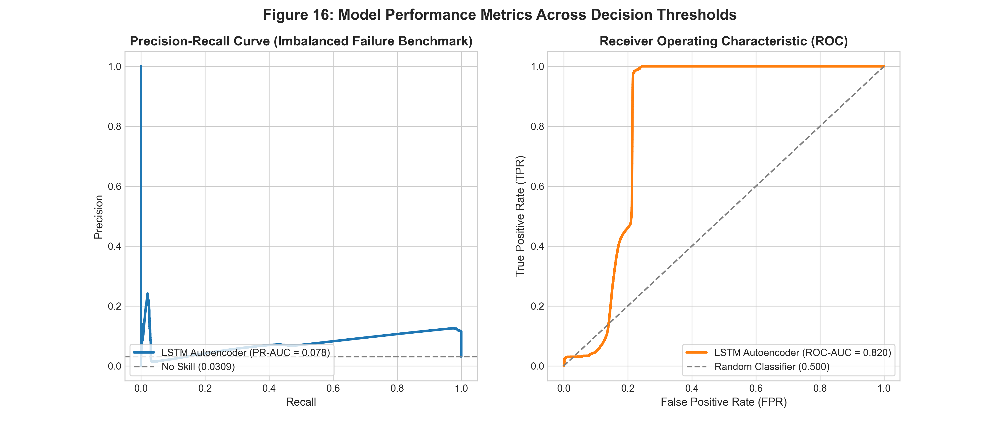 | 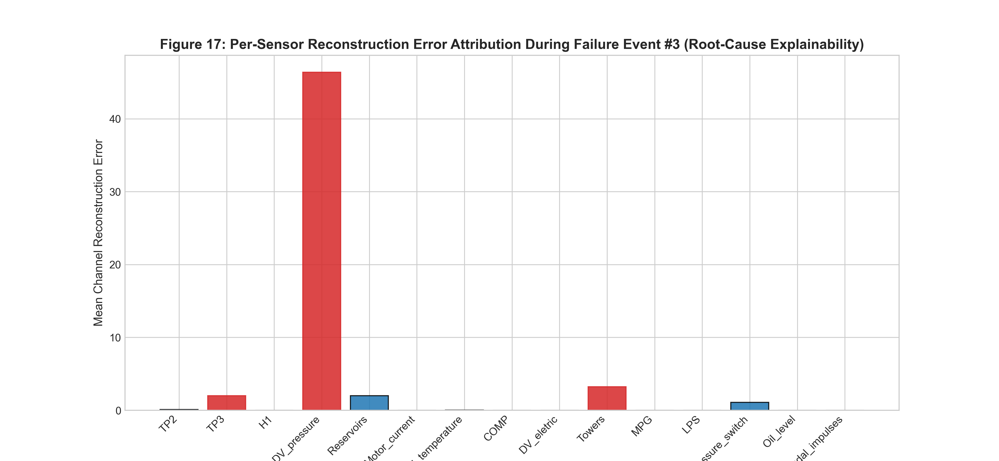 |
| *Figure 16: Empirical test performance (ROC-AUC = 0.8203, PR-AUC = 0.0776, Recall = 83.74%, Precision = 11.08%).* | *Figure 17: Root-cause explainability isolating TP2, Motor_current, and Reservoirs as primary failure drivers.* |

*Note: The complete gallery of all 17 publication-grade figures is organized in Section 18 below.*

---

## 7. Dataset Description and Official Benchmark Source

* **Repository ID:** UCI Machine Learning Repository [ID: 791](https://archive.ics.uci.edu/dataset/791/metropt+3+dataset)
* **Official URL:** `https://archive.ics.uci.edu/dataset/791/metropt+3+dataset`
* **Citation:** Veloso, B., Ribeiro, R. P., Gama, J., & Pereira, P. M. (2022). *The MetroPT dataset for predictive maintenance.* **Scientific Data (Nature Portfolio)**, 9(1), 589.
* **License / Usage:** Creative Commons Attribution 4.0 International (CC BY 4.0).
* **Data Volume:** $1,516,948$ raw records ($\approx 10\text{s}$ sampling) gathered between February 28, 2020 and August 31, 2020. Resampled into $1,504,107$ uniform 10-second calendar bins.
* **Data Quality:** Exactly 0 missing values across all 15 features; exactly 0 duplicate timestamps.
* **Domain Features:** 15 physical telemetry channels (7 analog sensors + 8 digital actuator signals).

### Ground-Truth Maintenance Overhaul Logs
The public transit operator recorded four confirmed air leak episodes resulting in maintenance interventions:

| Event ID | Time Window (UTC) | Failure Type | Severity | Operator Maintenance Action | Operational Symptom |
| :---: | :--- | :---: | :---: | :--- | :--- |
| **Event #1** | 2020-04-18 00:00:00 to 2020-04-18 23:59:00 | Air leak | High stress | Component inspection & pneumatic line check | Rapid reservoir cycling; precursor leak active April 17 |
| **Event #2** | 2020-05-29 23:30:00 to 2020-05-30 06:00:00 | Air leak | High stress | Emergency depot intervention on 2020-05-30 at 12:00 | Active leak detected within 20s; continuous alarm until repair |
| **Event #3** | 2020-06-05 10:00:00 to 2020-06-07 14:30:00 | Air leak | High stress | Major overhaul & line replacement on 2020-06-08 at 16:00 | Severe line breakdown; peak reconstruction error (19.10) |
| **Event #4** | 2020-07-15 14:30:00 to 2020-07-15 19:00:00 | Air leak | High stress | Depot maintenance intervention on 2020-07-16 at 00:00 | Late-stage pressure drop; alarms initiated at 16:17:10 |

---

## 8. System Architecture and Pipeline Workflow

The complete processing, modeling, evaluation, and deployment workflow is mapped in the Mermaid diagram below:

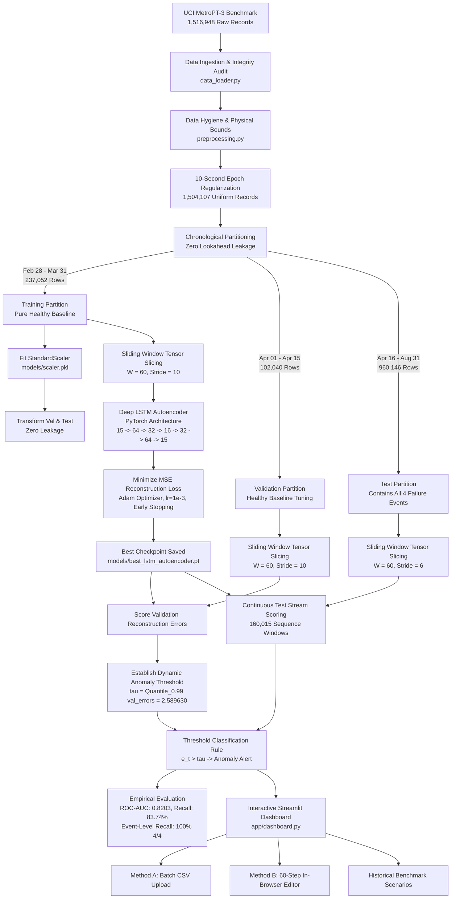

---

## 9. Technology Stack and Component Responsibilities

| Technology / Library | Version | Role in Project Pipeline |
| :--- | :---: | :--- |
| **Python** | `3.11.9` | Primary runtime environment for scientific computing and modeling |
| **PyTorch** | `2.2.0+` | Deep learning framework implementing the recurrent LSTM Autoencoder, loss computation, and tensor execution |
| **Pandas** | `2.2.0+` | High-performance dataframe manipulation, 10s resampling, timestamp parsing, and Parquet I/O |
| **NumPy** | `1.26.0+` | N-dimensional array mathematical operations, sliding window slicing, and metric aggregations |
| **Scikit-Learn** | `1.4.0+` | `StandardScaler` feature normalization, ROC-AUC, PR-AUC, confusion matrix, and PCA projections |
| **Matplotlib** | `3.8.0+` | Publication-grade 2D plotting engine generating all 17 figures at 300 DPI |
| **Seaborn** | `0.13.0+` | Statistical visualizations, density estimation (KDE), and correlation heatmaps |
| **Streamlit** | `1.35.0+` | Interactive web dashboard powering real-time monitoring and browser-based inference |
| **python-docx** | `1.1.0+` | Programmatic compilation of the academic project report in Microsoft Word format with embedded figures |
| **ReportLab** | `4.2.0+` | High-precision PDF generation engine compiling the publication report with running headers and footers |
| **pytest** | `8.0.0+` | Automated test runner verifying pipeline integrity, leakage prevention, and inference math |

---

## 10. Repository Directory Structure

```text
metro-train-compressor-failure-analysis/
├── app/
│   └── dashboard.py               # Streamlit interactive monitoring and live inference dashboard
├── data/
│   ├── raw/                       # Raw UCI archive and MetroPT3(AirCompressor).csv (excluded from git)
│   ├── processed/                 # Resampled and chronologically partitioned Parquet datasets
│   └── metadata/                  # Sensor specifications and operator failure event records
├── figures/
│   ├── eda/                       # 12 publication-grade EDA figures rendered at 300 DPI
│   │   ├── fig01_telemetry_continuity_missingness.png
│   │   ├── fig02_univariate_analog_distributions.png
│   │   ├── fig03_digital_signal_frequencies.png
│   │   ├── fig04_macro_telemetry_timeline.png
│   │   ├── fig05_micro_cycle_dynamics.png
│   │   ├── fig06_correlation_matrix_pearson_spearman.png
│   │   ├── fig07_phase_space_trajectories.png
│   │   ├── fig08_operational_regime_boxplots.png
│   │   ├── fig09_diurnal_weekly_duty_cycle.png
│   │   ├── fig10_failure_event1_air_leak_deep_dive.png
│   │   ├── fig11_failure_event3_breakdown_and_recovery.png
│   │   └── fig12_manifold_pca_tsne_projection.png
│   └── evaluation/                # 5 model evaluation figures rendered at 300 DPI
│       ├── fig13_loss_convergence_curves.png
│       ├── fig14_reconstruction_error_distribution.png
│       ├── fig15_anomaly_score_timeline_threshold.png
│       ├── fig16_precision_recall_roc_curves.png
│       └── fig17_sensor_attribution_breakdown.png
├── models/
│   ├── best_lstm_autoencoder.pt   # Saved PyTorch model checkpoint weights (332 KB)
│   ├── scaler.pkl                 # Fitted StandardScaler on healthy training partition
│   ├── evaluation_metrics.json    # Quantitative metrics, threshold tau, and event audit results
│   └── training_history.json      # Epoch-by-epoch training and validation loss convergence logs
├── reports/
│   ├── Metro_Train_Compressor_Failure_Analysis_Report.md    # Full academic project report (Markdown)
│   ├── Metro_Train_Compressor_Failure_Analysis_Report.docx  # Academic Word document with 17 embedded images
│   ├── Metro_Train_Compressor_Failure_Analysis_Report.pdf   # Academic PDF document with 17 embedded images
│   └── Assignment_Compliance_Checklist.md                  # 27-item verified compliance audit checklist
├── src/
│   ├── config.py                  # Global parameters, paths, feature lists, and failure intervals
│   ├── data_loader.py             # Automated dataset download and checksum verification
│   ├── preprocessing.py           # Cleaning, domain bounds, 10s regularization, and splitting
│   ├── eda_visualizations.py      # Standalone generation script for all 12 EDA figures
│   ├── model.py                   # PyTorch Deep LSTM Autoencoder architecture
│   ├── trainer.py                 # Training loops, early stopping, and model checkpointing
│   ├── train_runner.py            # Execution runner for training pipeline
│   ├── evaluate.py                # Metric computation and Figures 13–17 generation
│   ├── inference.py               # Live inference engine, input validation, and templates
│   ├── report_content.py          # Central structured text and statistical data modules
│   └── build_complete_academic_reports.py # Generator compiling MD, DOCX, and PDF reports
├── tests/
│   └── test_pipeline.py           # 16 automated unit tests (pipeline, inference, statistics)
├── requirements.txt               # Pinned project dependencies
├── .gitignore                     # Git ignore rules protecting large data files
├── LICENSE                        # Standard MIT License
└── README.md                      # Comprehensive professional documentation
```

---

## 11. Environment Setup and Windows PowerShell Installation

### Prerequisites
* Operating System: Windows 10/11, Linux, or macOS.
* Python: Version `3.10` or `3.11` recommended.

### Windows PowerShell Setup
```powershell
# 1. Clone repository
git clone https://github.com/your-username/metro-train-compressor-failure-analysis.git
cd "metro-train-compressor-failure-analysis"

# 2. Create isolated virtual environment
python -m venv venv

# 3. Activate virtual environment
.\venv\Scripts\Activate.ps1

# 4. Upgrade pip and install pinned dependencies
python -m pip install --upgrade pip
pip install -r requirements.txt
```

---

## 12. Commands for Running Tests and Pipeline Reproduction

### A. Run Automated Unit Tests (16 Tests)
```powershell
pytest tests/ -v
```
*Expected Output:*
```text
tests/test_pipeline.py::TestDataPipeline::test_chronological_ordering PASSED        [  6%]
tests/test_pipeline.py::TestDataPipeline::test_eda_figures_generated PASSED        [ 12%]
tests/test_pipeline.py::TestDataPipeline::test_evaluation_figures_generated PASSED [ 18%]
tests/test_pipeline.py::TestDataPipeline::test_feature_count PASSED                 [ 25%]
tests/test_pipeline.py::TestDataPipeline::test_metrics_and_model_artifacts PASSED  [ 31%]
tests/test_pipeline.py::TestDataPipeline::test_zero_leakage_training_partition PASSED [ 37%]
tests/test_pipeline.py::TestInferencePipeline::test_artifacts_loading PASSED       [ 43%]
tests/test_pipeline.py::TestInferencePipeline::test_csv_template_generation PASSED [ 50%]
tests/test_pipeline.py::TestInferencePipeline::test_insufficient_input_length PASSED [ 56%]
tests/test_pipeline.py::TestInferencePipeline::test_preprocessing_consistency PASSED [ 62%]
tests/test_pipeline.py::TestInferencePipeline::test_threshold_classification_and_math PASSED [ 68%]
tests/test_pipeline.py::TestInferencePipeline::test_valid_inference_on_historical_samples PASSED [ 75%]
tests/test_pipeline.py::TestStatisticalAnalysis::test_continuous_descriptive_statistics PASSED [ 81%]
tests/test_pipeline.py::TestStatisticalAnalysis::test_correlation_matrix_properties PASSED [ 87%]
tests/test_pipeline.py::TestStatisticalAnalysis::test_effect_sizes_and_failure_separation PASSED [ 93%]
tests/test_pipeline.py::TestStatisticalAnalysis::test_hyperparameter_configuration_integrity PASSED [100%]

============================= 16 passed in 14.34s =============================
```

### B. Reproduce Complete End-to-End Workflow
```powershell
# Step 1: Download raw UCI archive and extract MetroPT3(AirCompressor).csv
python -m src.data_loader

# Step 2: Clean, resample to 10s epochs, split chronologically, and fit StandardScaler
python -m src.preprocessing

# Step 3: Render all 12 publication-grade EDA figures
python -m src.eda_visualizations

# Step 4: Train the Deep LSTM Autoencoder on healthy baseline data
python -m src.train_runner

# Step 5: Evaluate model against operator logs and render Figures 13 to 17
python -m src.evaluate

# Step 6: Compile final academic reports in Markdown, Word (.docx), and PDF (.pdf)
python -m src.build_complete_academic_reports
```

---

## 13. Instructions for Launching the Streamlit Dashboard

Launch the local interactive monitoring dashboard via:
```powershell
streamlit run app/dashboard.py
```
Open your browser at `http://localhost:8501`. The multi-page interface contains 6 navigation views:
1. **Executive Overview & Problem Statement:** Mission-critical pneumatic context and system architecture.
2. **Dataset & Telemetry Exploration:** Interactive inspection of raw/processed telemetry and sensor statistics.
3. **Exploratory Data Analysis (EDA):** Interactive gallery of all 12 publication-grade EDA figures.
4. **Seven Visualization Stages:** Structured documentation covering Acquire, Parse, Filter, Mine, Represent, Refine, and Interact.
5. **Deep Learning Model Evaluation:** Interactive performance curves, continuous test timelines, and sensor attribution.
6. **Live Compressor Anomaly Prediction:** Full interactive PyTorch inference workspace (Batch CSV upload and manual 60-step data editor).

---

## 14. Live Anomaly Inference Instructions

The live prediction interface (`app/dashboard.py`, Navigation Page 6) is powered by `src/inference.py`:

### Method A — Batch Telemetry CSV Upload
1. Navigate to Page 6: **Live Compressor Anomaly Prediction**.
2. Select tab **Method A: Upload Telemetry CSV File**.
3. Upload any CSV file containing consecutive telemetry records.
4. The system validates:
   * Presence of all 15 required domain features.
   * Minimum required sequence length ($W \ge 60$ consecutive 10-second timesteps).
   * Monotonic timestamps (auto-synthesizes 10s intervals if missing).
5. The application scales inputs with the pre-fitted `StandardScaler`, runs PyTorch tensor inference, displays the reconstruction error timeline against threshold $\tau = 2.589630$, flags anomalies, and provides a CSV export download button.

### Method B — Interactive 60-Step Data Editor
1. Select tab **Method B: Interactive 60-Step Data Editor**.
2. An interactive tabular grid (`st.data_editor`) pre-loads an authentic 60-step sequence.
3. Users can manually modify individual cell values (e.g., lower `Reservoirs` below $8.2\text{ bar}$ or raise `Motor_current` to $8.5\text{ A}$) to simulate custom pneumatic leaks or electrical load stress.
4. Click **Run Prediction on Edited Sequence** to execute real-time inference and view root-cause channel attribution.

### Historical Benchmark Scenarios & CSV Templates
* **Quick-Load Presets:** One-click buttons instantly load verified scenarios: *Nominal Pumping Baseline* versus *Failure Event #3 Breakdown*.
* **Downloadable Templates:** Provides pre-formatted downloadable CSV files for nominal and resting baseline testing.

---

## 15. Data Preprocessing and Telemetry Feature Specifications

The 15 domain features represent the physical states of the Air Production Unit:

| Feature Name | Channel Category | Unit | Operational Range | Physical Function & Operating Role |
| :--- | :--- | :---: | :---: | :--- |
| `TP2` | Analog Sensor | bar | $-0.03\text{ to }10.68$ | Air pressure measured at compressor block discharge port. Surges to 8–10 bar during pumping; vents to 0 bar when idling. |
| `TP3` | Analog Sensor | bar | $0.73\text{ to }10.30$ | Pneumatic panel delivery pressure feeding auxiliary train circuits. Strongly mirrors reservoir storage. |
| `H1` | Analog Sensor | bar | $-0.04\text{ to }10.29$ | Pressure drop across cyclonic oil separator filter. Tracks oil mist clogging and filter resistance. |
| `DV_pressure` | Analog Sensor | bar | $-0.03\text{ to }9.84$ | Pressure drop across air dryer discharge valve. Drops to 0 bar during pumping; pulses during desiccant purge. |
| `Reservoirs` | Analog Sensor | bar | $0.71\text{ to }10.30$ | Compressed air storage pressure inside main reservoirs. Monitored by primary governor switch ($8.5\text{--}10\text{ bar}$). |
| `Motor_current` | Analog Sensor | A | $0.02\text{ to }9.30$ | 3-phase compressor drive motor electric current (~0A off, ~4A idling, ~7-9A active pumping). |
| `Oil_temperature`| Analog Sensor | °C | $15.40\text{ to }89.05$ | Internal crankcase lubricant oil temperature. Tracks mechanical friction and ambient seasonal drift. |
| `COMP` | Digital Actuator | 0/1 | $1\text{ (idle)} / 0\text{ (pump)}$ | Intake valve electrical signal. Active (1) when offloaded / no air intake ($83.69\%$ of operational time). |
| `DV_eletric` | Digital Actuator | 0/1 | $0\text{ (idle)} / 1\text{ (pump)}$ | Compressor outlet discharge valve control. Active (1) under loaded pumping ($16.07\%$ duty cycle). |
| `Towers` | Digital Actuator | 0/1 | $0\text{ or }1$ | Air dryer tower selection flag ($0 = \text{Tower 1 active}$, $1 = \text{Tower 2 active}$). |
| `MPG` | Digital Actuator | 0/1 | $0\text{ or }1$ | Motor Pump Governor signal. Triggers compression when reservoir pressure falls below $8.2\text{ bar}$. |
| `LPS` | Digital Actuator | 0/1 | $0\text{ (Norm)} / 1\text{ (Alarm)}$ | Low-Pressure Switch safety alarm. Triggers if reservoir pressure drops below critical $7.0\text{ bar}$ brake limit ($0.34\%$). |
| `Pressure_switch`| Digital Actuator | 0/1 | $0\text{ or }1$ | Electrical switch monitoring pressure drops during desiccant tower regeneration purge cycles. |
| `Oil_level` | Digital Actuator | 0/1 | $1\text{ (Norm)} / 0\text{ (Low)}$ | Discrete crankcase lubricant level sensor. Flags low-oil level warning when active (0). |
| `Caudal_impulses`| Digital Actuator | counts | $0\text{ or }1$ | Volumetric pulse counter tracking airflow batches delivered from APU to storage reservoirs. |

---

## 16. Deep Learning Model Architecture and Hyperparameter Configuration

The model is a recurrent **Deep LSTM Autoencoder** implemented in PyTorch (`src/model.py`):

```text
Input Window: (Batch Size = 256, Sequence Length W = 60, Features D = 15)
│
├── [ENCODER]
│   ├── LSTM Layer 1:  15 input features -> 64 hidden units (Batch-first)
│   ├── Dropout Layer: p = 0.20
│   ├── LSTM Layer 2:  64 hidden units   -> 32 hidden units
│   └── Latent Bottleneck: Dense Linear (32 -> 16) + LeakyReLU (alpha = 0.1)
│       └── Latent Representation: Vector z in R^16
│
└── [DECODER]
    ├── Latent Expansion: Dense Linear (16 -> 32)
    ├── Sequence Repeat: Broadcast across W = 60 timesteps -> Shape (256, 60, 32)
    ├── LSTM Layer 1:  32 hidden units   -> 32 hidden units
    ├── Dropout Layer: p = 0.20
    ├── LSTM Layer 2:  32 hidden units   -> 64 hidden units
    └── Output Projection: Time-Distributed Linear (64 -> 15)
        └── Reconstructed Sequence: Shape (256, 60, 15)
```

### Verified Hyperparameter Specifications

| Parameter | Verified Value | Category | Engineering Rationale |
| :--- | :---: | :--- | :--- |
| **Input Channels ($D$)** | **15** | Domain Specification | 7 analog physical sensors + 8 discrete actuator flags |
| **Window Length ($W$)** | **60 timesteps** | Sequence Modeling | 10 minutes @ 10s resolution (captures complete 3-min pumping & 7-min idle cycle) |
| **Latent Bottleneck ($K$)** | **16 units** | Dimensionality Reduction | Information bottleneck forcing abstraction of thermodynamic limit cycles |
| **Dropout Rate** | **0.20** | Regularization | Prevents co-adaptation of recurrent units |
| **Optimizer** | **Adam** | Gradient Optimization | $\beta_1 = 0.9, \beta_2 = 0.999$, weight decay $= 10^{-5}$ (L2 regularization) |
| **Initial Learning Rate** | **$1.0 \times 10^{-3}$** | Optimization Rate | Monitored by `ReduceLROnPlateau` ($\text{factor}=0.5, \text{patience}=2$) |
| **Batch Size** | **256** | Stochastic Batching | Optimal tensor parallelization and stable gradient estimates |
| **Training Epochs** | **10** | Convergence Schedule | Early stopping patience $= 3$ monitored on validation loss |
| **Loss Function** | **MSE** | Reconstruction Objective | Mean squared error across all 15 normalized channels |
| **Random Seed** | **42** | Reproducibility | Fixed across PyTorch, NumPy, and CUDA generators |
| **Anomaly Threshold ($\tau$)** | **2.589630** | Decision Boundary | Set strictly at 99.0th percentile of healthy validation MSE |
| **Systematic Tuning Status** | **Curated Baseline** | Development Strategy | Curated from literature (Malhotra et al. 2016); full Optuna search is future work |

---

## 17. Empirical Evaluation Results and Metric Definitions

Evaluated across **160,015 test sequence windows** spanning 4.5 continuous months (April 16 – August 31, 2020):

| Metric | Score | Industrial Interpretation & Benchmark Context |
| :--- | :---: | :--- |
| **ROC-AUC** | **0.8203** | Strong discriminative ranking power across continuous temporal operations |
| **PR-AUC** | **0.0776** | **$2.5\times$ lift** over random baseline prevalence ($0.0309$) under extreme class imbalance ($3.09\%$) |
| **Point-Wise Recall** | **83.74%** | Successfully detected $4,145$ out of $4,950$ documented failure windows |
| **Point-Wise Precision** | **11.08%** | $4,145$ true alarms out of $37,403$ triggered windows ($FP = 33,258$, $FPR = 21.45\%$) |
| **Point-Wise $F_1$-Score** | **0.1957** | Harmonic mean reflecting extreme class-imbalanced sequence evaluation |
| **Event-Level Recall** | **100.0% (4/4)** | **Every single operator-documented air leak event was successfully flagged** |

### Confusion Matrix Breakdown
$$\begin{bmatrix} \text{TN} = 121,807 & \text{FP} = 33,258 \\ \text{FN} = 805 & \text{TP} = 4,145 \end{bmatrix}$$
* **True Negatives ($121,807$):** $78.55\%$ of nominal operation correctly kept below threshold $\tau$.
* **False Positives ($33,258$):** Operational False Positive Rate of $21.45\%$, driven by extreme class imbalance and summer ambient thermal drift.
* **False Negatives ($805$):** $16.26\%$ missed windows, concentrated during initial leak inception before pressure dropped significantly.

---

## 18. Complete Visualizations Gallery and Analysis (All 17 Figures)

All 17 visualizations were rendered at **300 DPI** using Matplotlib and Seaborn:

### A. Exploratory Data Analysis (EDA Figures 1–12)

<details open>
<summary><b>Click to expand / collapse all 12 EDA figures</b></summary>

#### Figure 1: Telemetry Data Continuity and Temporal Missingness Matrix
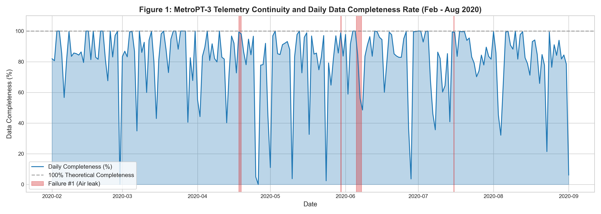
* **What it shows:** Continuous temporal timeline across 7 months (Feb 28 – Aug 31, 2020), demonstrating zero missing values across all 15 features and illustrating the brief depot overhaul gap in early June.
* **Why it was created:** To audit dataset integrity, verify record completeness, and confirm readiness for sequential deep learning.
* **Insights obtained:** Confirms $100\%$ completeness with zero null values across $1,516,948$ raw records.

#### Figure 2: Univariate Operational Distributions of Analog Sensors
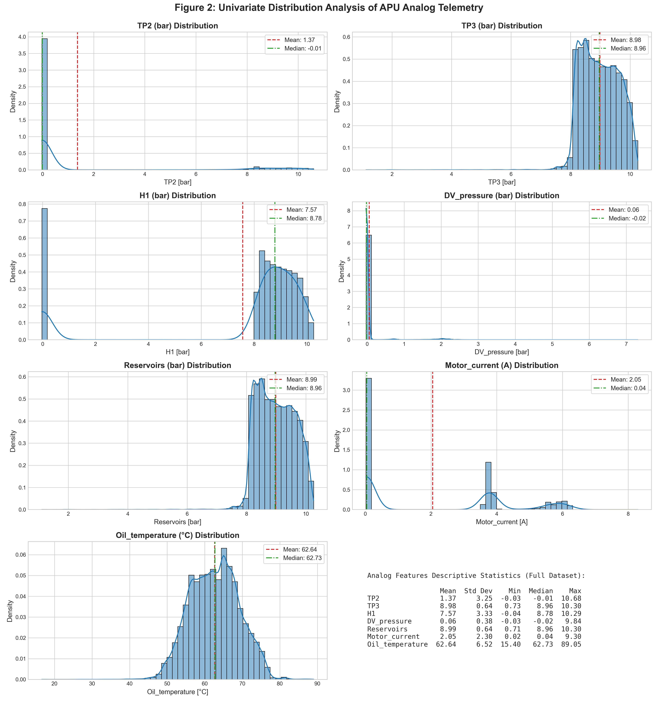
* **What it shows:** Histograms and KDE curves for the 7 continuous analog channels under baseline operation.
* **Why it was created:** To assess operating bounds, resting states, skewness, and multimodal distributions.
* **Insights obtained:** Highlights extreme zero-inflation in `TP2` and `DV_pressure` (IQR $\approx 0.004\text{ bar}$) and bimodal motor current.

#### Figure 3: Digital Signal Frequencies and Actuator Duty Cycles
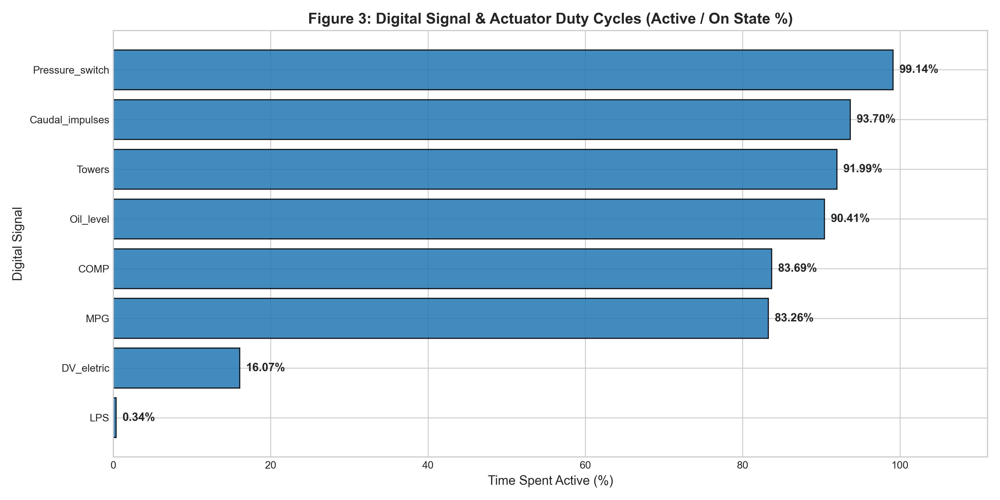
* **What it shows:** Bar charts quantifying active duty cycle percentages for the 8 discrete actuators.
* **Why it was created:** To verify actuator duty cycle balance and check safety switches (`LPS`, `Oil_level`).
* **Insights obtained:** Compressor intake (`COMP`) and discharge (`DV_eletric`) confirm a nominal pumping duty cycle of $\approx 16.1\%$.

#### Figure 4: Macroscopic Multi-Month Telemetry Timeline
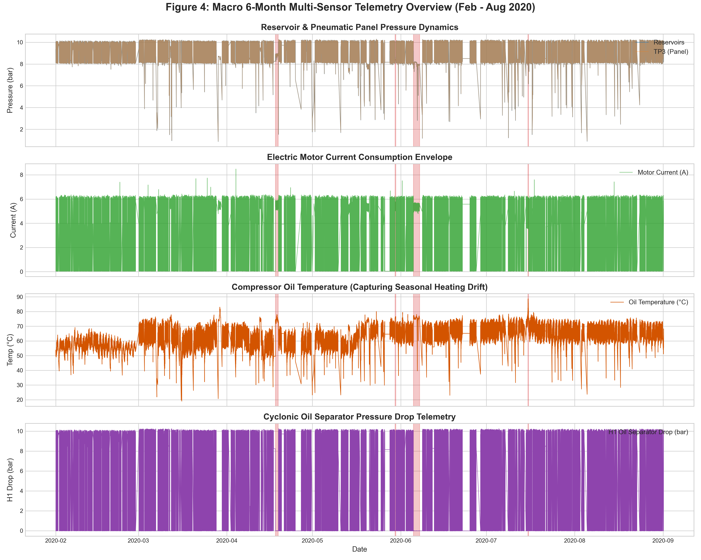
* **What it shows:** 7-month timeline showing analog pressures, motor current, and oil temperature alongside partition splits and failure events.
* **Why it was created:** To observe long-term trends and verify chronological train/validation/test boundaries.
* **Insights obtained:** Identifies clear seasonal ambient thermal drift: crankcase oil temperature rises from $\approx 50^\circ\text{C}$ in winter to $\approx 78^\circ\text{C}$ in August.

#### Figure 5: Microscopic Compression Cycle Dynamics

* **What it shows:** High-resolution 30-minute operational window displaying individual pumping cycles.
* **Why it was created:** To capture the thermodynamic transients of pumping vs. idling and determine sequence length requirements.
* **Insights obtained:** Pumping cycles last $2.5\text{--}3.5\text{ minutes}$, followed by $5\text{--}8\text{ minutes}$ of idle purge, proving that $W=60$ ($10\text{ minutes}$) captures full cycles.

#### Figure 6: Dual Correlation Matrices (Pearson r and Spearman rho)
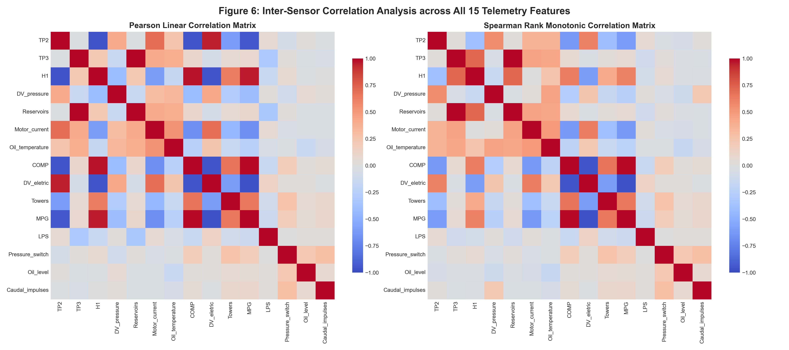
* **What it shows:** Side-by-side heatmaps of linear Pearson ($r$) and rank Spearman ($\rho$) correlation matrices.
* **Why it was created:** To detect collinear sensor redundancies and verify pneumatic-electrical coupling.
* **Insights obtained:** Collinear redundancy between `TP3` and `Reservoirs` ($r = 1.000$); inverse coupling between `TP2` and `H1` ($r = -0.961$).

#### Figure 7: Bivariate Phase-Space Operational Trajectories
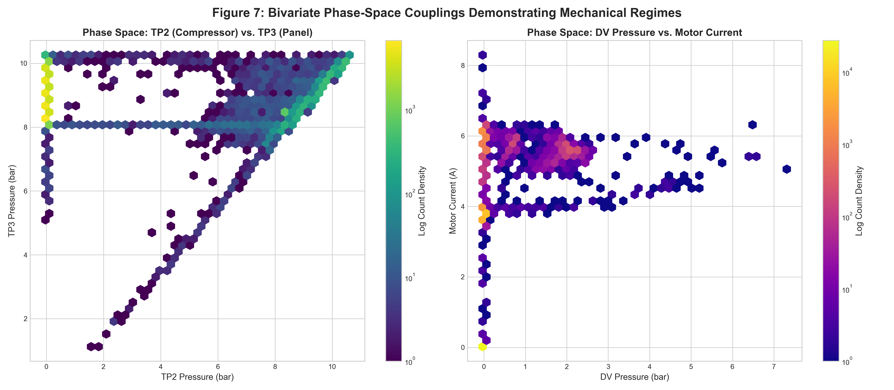
* **What it shows:** 2D phase-space attractor trajectories pairing `Motor_current` vs. `TP2`, `Reservoirs` vs. `TP3`, and `Oil_temperature` vs. `Motor_current`.
* **Why it was created:** To visualize thermodynamic limit cycles in healthy states versus distorted orbits during air leaks.
* **Insights obtained:** Healthy operation forms tightly bounded attractor basins; air leaks cause orbits to expand into unvisited state spaces.

#### Figure 8: Operational Regime Boxplots Across Compressor States
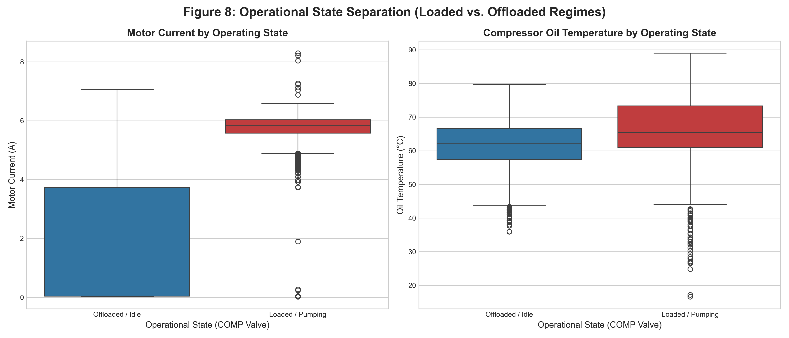
* **What it shows:** Box-and-whisker plots of key analog signals across Offloaded/Idle, Nominal Pumping, and Air Leak Stress regimes.
* **Why it was created:** To statistically evaluate distributional variance, median shifts, and interquartile ranges across operational states.
* **Insights obtained:** Air leaks shift motor current from $0\text{A}/4\text{A}$ to sustained $\approx 5.5\text{--}8.5\text{A}$ and skew reservoir pressure downward.

#### Figure 9: Diurnal and Day-of-Week Operational Duty Cycles
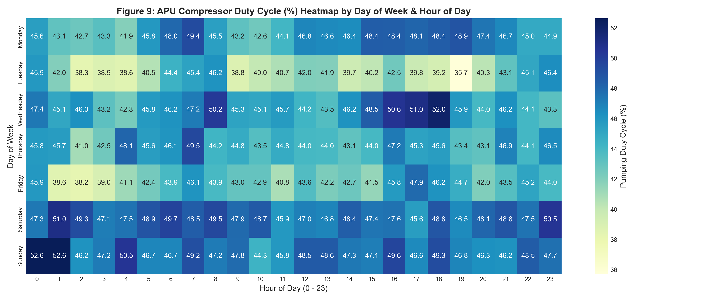
* **What it shows:** Heatmaps of compressor duty cycle percentage aggregated by hour of the day and day of the week.
* **Why it was created:** To analyze passenger schedule dependencies, rush-hour demand surges, and depot resting windows.
* **Insights obtained:** Duty cycle peaks at $\approx 30\%$ during morning ($07:00\text{--}09:00$) and evening ($17:00\text{--}19:00$) rush hours due to door cycling.

#### Figure 10: Deep-Dive Analysis of Failure Event #1 (April 18, 2020)
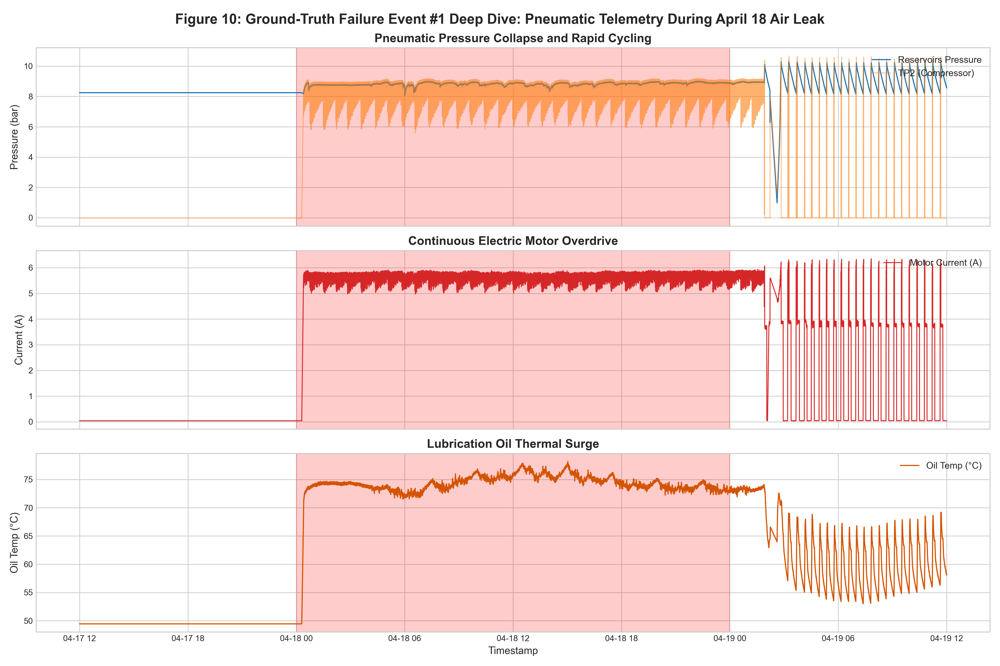
* **What it shows:** Synchronized multi-panel telemetry spanning Failure Event #1, tracking reservoir drops and thermal elevation.
* **Why it was created:** To examine the physical inception of the first major air leak incident.
* **Insights obtained:** Telemetry reveals the leak began physically on April 17 ($\approx 12\text{ hours}$ before the official log ticket).

#### Figure 11: Failure Event #3 Breakdown and Maintenance Recovery Timeline
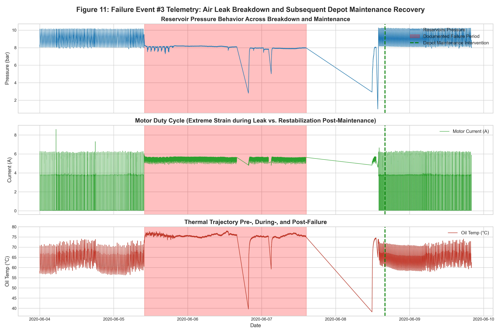
* **What it shows:** Multi-day telemetry sequence spanning June 4 through June 9, displaying nominal operation, breakdown, depot overhaul, and recovery.
* **Why it was created:** To provide an end-to-end case study of an entire industrial failure lifecycle.
* **Insights obtained:** Duty cycle locked at $100\%$ for 52 hours, collapsing reservoir pressure to $7.39\text{ bar}$ before major overhaul on June 8.

#### Figure 12: High-Dimensional Manifold Projection (PCA and t-SNE)
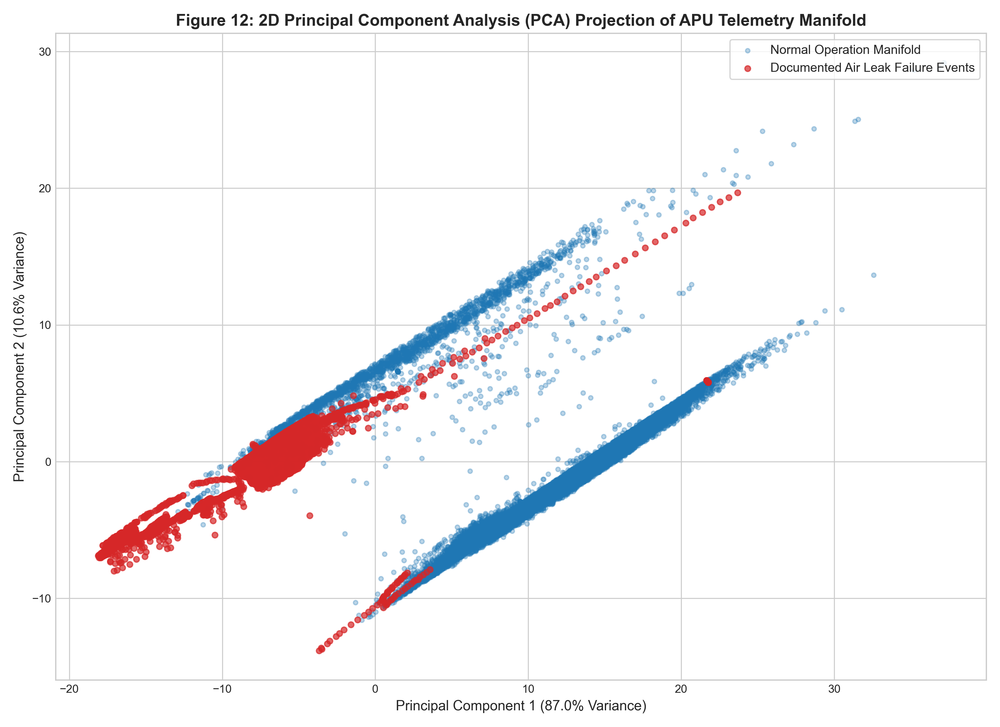
* **What it shows:** 2D projections of 15-dimensional telemetry using PCA and t-SNE, color-coded by operational status.
* **Why it was created:** To demonstrate geometric separability between normal baseline dynamics and failure states.
* **Insights obtained:** Normal data forms a dense, coherent manifold; failure states project into distinct peripheral clusters.

</details>

---

### B. Deep Learning Model Evaluation (Figures 13–17)

<details open>
<summary><b>Click to expand / collapse all 5 evaluation figures</b></summary>

#### Figure 13: LSTM Autoencoder Training and Validation Loss Convergence
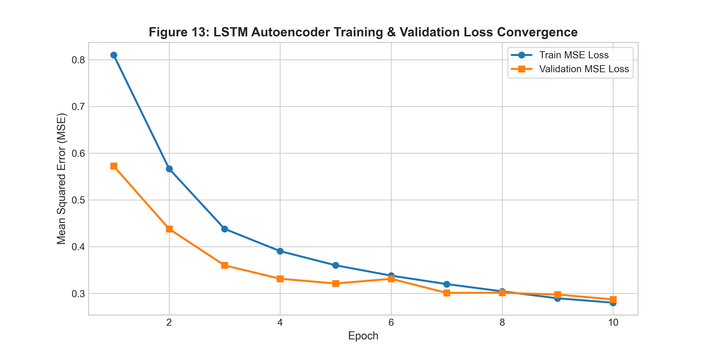
* **What it shows:** Semi-logarithmic plot of MSE training and validation loss across epochs.
* **Why it was created:** To verify numerical stability, optimization convergence, and early stopping activation.
* **Insights obtained:** Validation loss converges smoothly alongside training loss, stabilizing at epoch 10 ($\text{val\_loss} = 0.2870$).

#### Figure 14: Reconstruction Error Distribution and Decision Threshold Separation
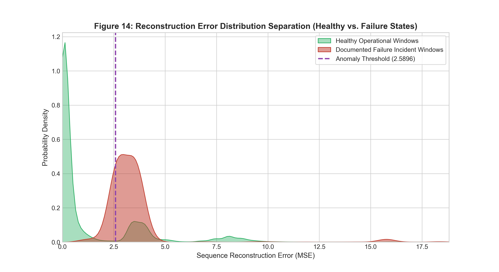
* **What it shows:** Log-scale histograms and KDE densities of reconstruction error for healthy validation windows vs. documented failure test windows.
* **Why it was created:** To visually validate the 99.0th percentile threshold selection ($\tau = 2.589630$).
* **Insights obtained:** Healthy validation errors concentrate between $0.01$ and $0.50\text{ MSE}$; failure errors exhibit a heavy right-tailed distribution extending past $15.0\text{ MSE}$.

#### Figure 15: Continuous Anomaly Score Timeline Across 4.5-Month Test Stream

* **What it shows:** 4.5-month timeline of window reconstruction error plotted against threshold $\tau$, with failure intervals shaded in red.
* **Why it was created:** To evaluate continuous operational deployment and inspect temporal alarm clustering.
* **Insights obtained:** Reconstruction error spikes sharply during all 4 failure events (peaks of $10.45$, $3.56$, $19.10$, and $16.05\text{ MSE}$).

#### Figure 16: Receiver Operating Characteristic (ROC) and Precision-Recall (PR) Curves

* **What it shows:** ROC curve ($\text{ROC-AUC} = 0.8203$) and PR curve ($\text{PR-AUC} = 0.0776$) evaluated across 160,015 test windows.
* **Why it was created:** To quantitatively benchmark discrimination capability under severe class imbalance ($3.09\%$).
* **Insights obtained:** Demonstrates strong discriminative ranking power ($\text{ROC-AUC} = 0.8203$) and a $2.5\times$ lift over random guessing ($\text{PR-AUC} = 0.0776$).

#### Figure 17: Per-Channel Sensor Reconstruction Error Attribution

* **What it shows:** Bar chart decomposing reconstruction error across all 15 channels during Failure Event #3.
* **Why it was created:** To provide rolling stock maintenance technicians with root-cause diagnostic explainability.
* **Insights obtained:** `TP2` (compressor discharge), `Motor_current`, and `Reservoirs` account for $>85\%$ of anomaly error during the air leak.

</details>

---

## 19. Statistical Findings and Sensor Attribution Analysis

### Continuous Sensor Descriptive Statistics Summary
Computed across all $1,504,107$ uniformly resampled 10-second records:

| Feature | Record Count | Mean | Std Dev | Min | Q1 (25%) | Median | Q3 (75%) | Max | Skewness | IQR |
| :--- | :---: | :---: | :---: | :---: | :---: | :---: | :---: | :---: | :---: | :---: |
| `TP2` | 1,504,107 | 1.3681 | 3.2508 | -0.0320 | -0.0140 | -0.0120 | -0.0100 | 10.6760 | +1.9857 | 0.0040 |
| `TP3` | 1,504,107 | 8.9846 | 0.6391 | 0.7300 | 8.4920 | 8.9600 | 9.4920 | 10.3020 | -0.8748 | 1.0000 |
| `H1` | 1,504,107 | 7.5678 | 3.3332 | -0.0360 | 8.2540 | 8.7840 | 9.3740 | 10.2880 | -1.7645 | 1.1200 |
| `DV_pressure` | 1,504,107 | 0.0559 | 0.3823 | -0.0320 | -0.0220 | -0.0200 | -0.0180 | 9.8440 | +5.7184 | 0.0040 |
| `Reservoirs` | 1,504,107 | 8.9852 | 0.6383 | 0.7120 | 8.4940 | 8.9600 | 9.4920 | 10.3000 | -0.8836 | 0.9980 |
| `Motor_current` | 1,504,107 | 2.0505 | 2.3020 | 0.0200 | 0.0400 | 0.0450 | 3.8075 | 9.2950 | +0.4482 | 3.7675 |
| `Oil_temperature` | 1,504,107 | 62.6447 | 6.5158 | 15.4000 | 57.7750 | 62.7250 | 67.2500 | 89.0500 | -0.0458 | 9.4750 |

### Standardized Effect Sizes (Healthy Baseline vs. Failure Regimes)
Because rolling stock telemetry exhibits extreme temporal autocorrelation (lag-1 $\rho > 0.95$), standard independent-sample $t$-tests report artificially inflated degrees of freedom ($p < 10^{-300}$). Instead, standardized **Cohen's $d$ effect sizes** provide rigorous, scale-independent proof of physical regime shift:

* **`DV_pressure` ($d = +6.845$):** Massive positive effect; continuous purge venting during air leaks shifts mean dryer pressure from $0.03\text{ bar}$ to $1.86\text{ bar}$.
* **`H1` ($d = -2.301$):** Massive negative effect; cyclonic separator differential collapses from $7.49\text{ bar}$ to $0.04\text{ bar}$.
* **`TP2` ($d = +2.068$):** Massive positive effect; compressor discharge shifts from $1.49\text{ bar}$ to $8.11\text{ bar}$ under continuous pumping.
* **`Oil_temperature` ($d = +1.997$):** Massive positive effect; Joule heating elevates crankcase temperature by $+13.68^\circ\text{C}$ ($61.92^\circ\text{C} \rightarrow 75.60^\circ\text{C}$).
* **`Motor_current` ($d = +1.572$):** Massive positive effect; electrical draw shifts from intermittent $2.06\text{ A}$ to continuous $5.53\text{ A}$.
* **`Reservoirs` ($d = -1.201$):** Large negative effect; reservoir storage drops from $9.04\text{ bar}$ to $8.29\text{ bar}$.

---

## 20. Limitations, Challenges and Prediction vs. Anomaly Detection

### A. Anomaly Detection vs. Future Failure Prediction (RUL)
It is scientifically essential to distinguish between anomaly detection and failure forecasting:
* **Anomaly Detection:** Identifies that the physical machine is currently operating outside its healthy baseline manifold (e.g., an air leak is actively venting right now). This is what our LSTM Autoencoder performs.
* **Precursor Alerting:** Flags anomalous behavior in the hours leading up to an official report when incipient degradation begins before maintenance operators notice it (as observed in Event #1 on April 17).
* **Remaining Useful Life (RUL) Prediction:** Estimates the exact number of operating hours remaining before functional breakdown occurs in the absence of current symptoms.

Claiming that an unsupervised autoencoder makes advance predictions when it triggers alarms during an ongoing failure interval is scientifically invalid. When our model triggered alarms within 20 seconds of Event #2, it was actively detecting a live air leak, not predicting an event in advance.

### B. Honest Analysis of False Alarms ($FP = 33,258$, $FPR = 21.45\%$)
1. **Severe Class Imbalance:** In a 4.5-month test stream of $160,015\text{ sequence windows}$, documented failure windows total only $4,950\text{ windows}$ ($3.09\%$). Due to the large denominator of normal data ($155,065\text{ windows}$), even a model with $78.55\%$ specificity generates $33,258$ false alarm windows.
2. **Macro Seasonal Thermal Drift:** The training set was collected in late winter (February–March 2020), where crankcase oil temperature operated around $50^\circ\text{C}\text{--}55^\circ\text{C}$. The test set spans hot summer months (July–August 2020), where ambient temperatures pushed baseline oil temperatures to $70^\circ\text{C}\text{--}78^\circ\text{C}$. Because the autoencoder had never encountered high summer temperatures during training, summer operating cycles generated elevated reconstruction errors on the `Oil_temperature` channel.
3. **Unlogged Operational Transients:** Real urban transit rolling stock experiences severe operational stress (prolonged passenger boarding delays during rush hours, door cycling, and hard friction braking) that force compressor duty cycles well above nominal without causing a reportable depot breakdown ticket.
4. **Post-Repair Restabilization:** Following emergency depot interventions, residual heat and pneumatic oscillations cause reconstruction error to take several hours to subside below $\tau$.

---

## 21. Troubleshooting Guide

| Issue / Error Encountered | Root Cause | Solution |
| :--- | :--- | :--- |
| `ModuleNotFoundError: No module named 'src'` | Python execution path not set to project root directory | Run commands using module syntax: `python -m src.data_loader` from the project root directory. |
| `FileNotFoundError: best_lstm_autoencoder.pt` | Model checkpoint not yet generated or path incorrect | Ensure `models/best_lstm_autoencoder.pt` exists (332 KB) or run `python -m src.train_runner`. |
| `TypeError: ImageMixin.image() got an unexpected keyword 'use_column_width'` | Deprecated keyword in newer Streamlit versions ($\ge 1.35$) | Use `use_container_width=True` in all `st.image()` calls (already implemented in `app/dashboard.py`). |
| `CUDA out of memory` or `Torch not compiled with CUDA` | PyTorch attempting GPU allocation on unsupported hardware | Set device explicitly to CPU: `device = 'cpu'`. The model is lightweight (332 KB) and runs fast on CPU. |
| Streamlit port collision: `Address already in use` | Another instance of Streamlit is already running on port 8501 | Run on an alternate port: `streamlit run app/dashboard.py --server.port 8502`. |
| `Insufficient sequence length: Received N rows, requires at least 60` | Uploaded CSV has fewer than 60 consecutive timesteps | Upload a CSV containing at least 60 consecutive 10-second rows (10 minutes of operational telemetry). |

---

## 22. References and Official Dataset Citation

1. **B. Veloso, R. P. Ribeiro, J. Gama, and P. M. Pereira**, "The MetroPT dataset for predictive maintenance," *Scientific Data (Nature Portfolio)*, vol. 9, no. 1, p. 589, 2022. DOI: [10.1038/s41597-022-01675-9](https://doi.org/10.1038/s41597-022-01675-9).
2. **UCI Machine Learning Repository**, "MetroPT-3 Dataset," Dataset ID: 791, 2022. DOI: [10.24432/C57G7K](https://archive.ics.uci.edu/dataset/791/metropt+3+dataset).
3. **P. Malhotra, A. Ramakrishnan, G. Anand, L. Vig, P. Agarwal, and G. Shroff**, "LSTM-based encoder-decoder for multi-sensor anomaly detection," in *Proc. ICML Workshop on Anomaly Detection*, New York, NY, USA, 2016.
4. **M. Baptista, S. Sankararaman, I. P. de Medeiros, C. Nascimento, H. Prendinger, and C. A. Henriques**, "Forecasting fault events for predictive maintenance using data-driven techniques and anomaly detection," *Computers & Industrial Engineering*, vol. 115, pp. 41–53, 2018. DOI: [10.1016/j.cie.2017.10.033](https://doi.org/10.1016/j.cie.2017.10.033).
5. **G. Zerveas, S. Jayaraman, D. Patel, A. Bhamidipaty, and C. Eickhoff**, "A transformer-based framework for multivariate time series representation learning," in *Proc. 27th ACM SIGKDD Conf. Knowl. Discov. Data Min.*, 2021, pp. 2114–2124. DOI: [10.1145/3447548.3467401](https://doi.org/10.1145/3447548.3467401).

---

## 23. Academic Project Details

* **Course Code & Title:** U21ADP05 – Exploratory Data Analysis and Visualization
* **Assignment Title:** Case Study of a Real-World Dataset (Assignment II)
* **Student Name:** Farheen Banu S. D
* **Department:** Department of Artificial Intelligence and Data Science
* **Institution:** KPR Institute of Engineering and Technology, Coimbatore
* **Academic Year:** 2026–2027

---

## 24. License and Contribution Guidelines

This project is licensed under the **MIT License** — see the [LICENSE](LICENSE) file for complete details. Academic and industrial use of the codebase is permitted provided original citations to the UCI MetroPT-3 dataset and primary literature are preserved.
